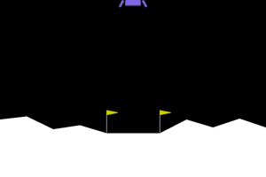
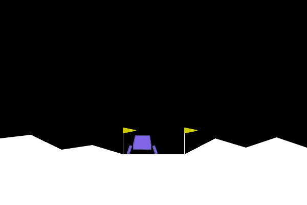

# Lunar Lander: reward shaping with PPO

Train an AI to land a rocket in Gymnasium's `LunarLander-v3`, then change what it
gets points for and watch it learn exactly what you scored (including the wrong
thing). Based on Hari's "Training an AI to land a rocket with reward shaping".

Runs on a laptop, no GPU. Python 3.12, Gymnasium with Box2D, Stable-Baselines3.



The baseline PPO agent after 1M training steps (about 2 minutes on an M-series Mac):
mean score 260.9 over 20 attempts, 20 of 20 landed. 200 counts as solved.



## Setup

Already done in this folder. To recreate it elsewhere:

```
brew install swig                     # Box2D needs it on macOS
uv venv --python 3.12 .venv
uv pip install --python .venv/bin/python -r requirements.txt
```

Activate with `source .venv/bin/activate`, or prefix commands with `.venv/bin/python`.

## The scripts, in the order the article uses them

| Step | Command | What it does |
|---|---|---|
| 2. Watch it fail | `python watch_random.py` | Random actions with the window on. Prints the eight observation numbers. |
| 3. Train it | `python train.py` | PPO, 1M steps, 16 parallel envs. Saves `models/none.zip`, curve in `logs/none/progress.csv`. |
| 4. Watch it land | `python evaluate.py --name none --render` | Loads the model, flies 20 attempts with the wrapper off, reports the mean. |
| 4. Record it | `python record.py --name none` | Writes `videos/none-episode-N.mp4`. |
| 4. Screenshot | `python make_screenshot.py --name none` | Writes `assets/landing.png` and `assets/landing.gif`. |
| 5. Your own reward | `python train.py --reward time --name time` | Tiny charge per frame. Should still land. |
| 6. Break it | `python train.py --reward hover --name hover` | +1 per frame upright and slow. Watch the clip. |
| 6. Fix it | `python train.py --reward fixed --name fixed` | Pay for improvement between frames, plus a per-frame fee. |

The reward rules live in `rewards.py`. Each one is a small `gym.Wrapper` subclass
with a `bonus()` method; add your own and register it in `REWARDS`.

## What to watch while training

Two numbers print every rollout:

- `ep_rew_mean`: the average shaped score (what PPO is optimizing, your bonus included).
- `rollout/raw_score_mean`: the true game score with your bonus stripped out.

If the first climbs while the second stalls or drops, the rocket found a way to farm
your rule. That is reward hacking. `evaluate.py` always uses the raw environment,
so your own bonus cannot flatter the final number. 200 or more on average is "solved".

## Notes

- Training is random. Run a reward more than once (`--seed 1`, `--seed 2`) before
  calling it good or bad. The hover hack may take a retrain or two to show up.
- Old tutorials say `LunarLander-v2`. Current Gymnasium only has v3.
- Hyperparameters in `train.py` come from the SB3 RL Zoo settings for Lunar Lander.
- Episodes are cut off at 1000 frames. `evaluate.py` labels those "TIMED OUT",
  which is the hover signature.

## Reading list

1. Stable-Baselines3: Install
2. Gymnasium: Basic Usage
3. Gymnasium: Lunar Lander (observation, actions, reward)
4. Hugging Face Deep RL Course, Unit 1 (says v2, use v3)
5. Stable-Baselines3: Examples (training, saving, loading, GIFs)
6. Gymnasium: Implementing Custom Wrappers
